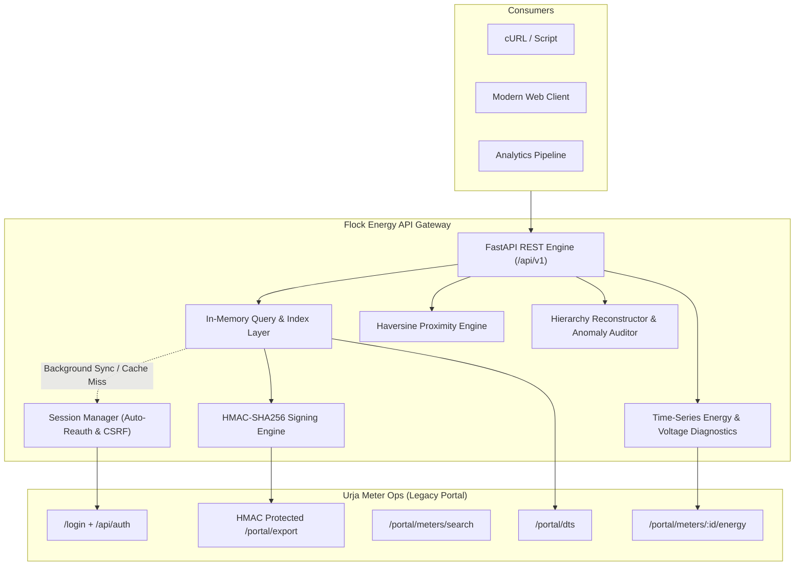

# Flock Energy — Urja Meter Ops Modern API & Query Service

[](https://www.python.org/downloads/)
[](https://fastapi.tiangolo.com)
[](openapi.json)
[](tests/)
[](Dockerfile)

A clean, robust, well-documented programmatic REST API service and local query layer built over the legacy **Urja Meter Ops** internal portal (`https://urja-ops.flockenergy.tech`).

This service enables engineers, data pipelines, and field applications to interact with smart-meter telemetry, technical nameplates, electrical network hierarchies, and time-series consumption records without ever touching the legacy web UI.

---

## ⚡ Quick Links & Primary Deliverables

| Deliverable | Location / Endpoint | Description |
| :--- | :--- | :--- |
| **Protocol Discovery Report** | [`PROTOCOL.md`](PROTOCOL.md) | Reverse-engineering breakdown: SvelteKit SSR, Better-Auth, HMAC-SHA256 signing, and legacy data quirks. |
| **OpenAPI Specification** | [`openapi.json`](openapi.json) | Full OpenAPI 3.1 schema of the clean service. |
| **Interactive Swagger Docs** | `http://localhost:8000/docs` | Live in-browser API explorer (Swagger UI). |
| **Alternative Docs (ReDoc)** | `http://localhost:8000/redoc` | Clean, reference-style API documentation. |
| **Modern Web Dashboard** | `http://localhost:8000/` | Interactive utility dashboard with maps, charts, and tree explorer. |
| **Engineering Reflection** | [`REFLECTION.md`](REFLECTION.md) | Answers to all 5 reflection and self-critique questions. |

---

## 🏗️ Architecture Overview

The Urja portal is an internal web UI with no documented public API. To provide programmatic access with high performance, resilience, and rich query capabilities, this service acts as an intelligent façade and local index layer:



### Core Architecture Components
1. **Intelligent Session Manager (`app/client/session.py`)**:
   - Handles SvelteKit CSRF headers (`Origin` and `Referer` verification).
   - Thread-safe / async mutex (`asyncio.Lock`) preventing concurrent thundering herds during re-login.
   - Monitors session expiration via `/api/auth/get-session` and automatically refreshes tokens upon `HTTP 401`.
2. **Cryptographic Upstream Client (`app/client/urja_client.py`)**:
   - Implements dynamic key discovery from `/portal/keys`.
   - Constructs HMAC-SHA256 signatures (`METHOD\nPATH\nQUERYSTRING\nTIMESTAMP`) satisfying the 300-second replay window.
   - Leverages `/portal/export` for sub-second bulk synchronization of all 403 meters.
3. **Harmonized Domain Services (`app/services/`)**:
   - **`meter_service.py`**: Normalizes divergent `legacy` (name-value array) and `v2` (JSON-encoded `classData`) schemas into a unified technical nameplate.
   - **`hierarchy_service.py`**: Reconstructs electrical distribution topologies (Zone → Circle → Division → Subdivision → Substation → Feeder → DT → Meter) and audits data anomalies.
   - **`energy_service.py`**: Converts raw string timestamp intervals into ISO-8601 datetimes, active kWh/apparent kVAh deltas, power factor estimations, and voltage quality bands.
   - **`index_service.py`**: In-memory multi-attribute query engine and geospatial search (Haversine formula).

---

## 📁 Repository Structure

```text
FlockEnergy/
├── app/
│   ├── config.py                 # Application settings via Pydantic Settings
│   ├── main.py                   # FastAPI app definition, CORS, lifespan, middleware
│   ├── api/
│   │   ├── __init__.py           # API package initialization
│   │   └── v1/
│   │       ├── __init__.py       # Router mounting under /api/v1
│   │       ├── meters.py         # Meter query, search, nearby, and detail endpoints
│   │       ├── energy.py         # Consumption interval history and analytics summary
│   │       ├── transformers.py   # Distribution transformer endpoints
│   │       ├── hierarchy.py      # Reconstructed hierarchy tree and anomaly report
│   │       └── system.py         # Health, fleet statistics, and sync endpoints
│   ├── client/
│   │   ├── session.py            # Token lifecycle, CSRF, auto-reauth, mutex lock
│   │   └── urja_client.py        # HTTP client, HMAC signing, bulk export, energy fetch
│   ├── models/
│   │   ├── meter.py              # Pydantic schemas for meters, nameplates, geolocation
│   │   ├── energy.py             # Pydantic schemas for time-series energy and voltage
│   │   ├── transformer.py        # Pydantic schemas for distribution transformers
│   │   ├── hierarchy.py          # Pydantic schemas for hierarchy trees and anomalies
│   │   └── query.py              # Pydantic schemas for pagination, nearby queries, KPIs
│   ├── services/
│   │   ├── meter_service.py      # Normalization of legacy vs v2 nameplate formats
│   │   ├── energy_service.py     # Energy consumption delta & voltage diagnostics
│   │   ├── hierarchy_service.py  # Hierarchy tree reconstruction & reconciliation
│   │   └── index_service.py      # In-memory index, multi-attribute filter, Haversine geo
│   └── static/
│       └── index.html            # Modern web dashboard (Chart.js, Leaflet.js, Tailwind)
├── tests/
│   ├── test_api.py               # End-to-end API route tests
│   ├── test_client.py            # HMAC signing & session manager unit tests
│   ├── test_energy.py            # Consumption delta and voltage band tests
│   ├── test_hierarchy.py         # Hierarchy reconstruction & anomaly detection tests
│   ├── test_normalization.py     # Legacy vs v2 nameplate normalization tests
│   └── test_proximity.py         # Great-Circle Haversine distance tests
├── Dockerfile                    # Containerization for one-command execution
├── docker-compose.yml            # Docker Compose multi-environment setup
├── openapi.json                  # Exported OpenAPI 3.1 specification
├── PROTOCOL.md                   # Full reverse-engineering discovery report
├── REFLECTION.md                 # 5 detailed engineering reflection questions
├── pytest.ini                    # Test runner configuration
├── requirements.txt              # Pinned Python dependencies
└── run.sh                        # One-command executable startup script
```

---

## 🚀 How to Install, Configure & Run

### Prerequisites
- Python 3.9+ (or Docker)
- Internet connection (to access `https://urja-ops.flockenergy.tech`)

### Option A: Local Run (Recommended, Instant)
```bash
# 1. Clone the repository
git clone <repo-url>
cd FlockEnergy

# 2. Run the startup script (automatically configures .venv and launches service)
./run.sh
```

Alternatively, manually setup:
```bash
python3 -m venv .venv
source .venv/bin/activate
pip install -r requirements.txt
uvicorn app.main:app --host 0.0.0.0 --port 8000 --reload
```

### Option B: Docker / Docker Compose
```bash
docker compose up --build
```

The service will start immediately, authenticate with the Urja portal, sync the fleet, and listen at **`http://localhost:8000`**.

---

## 📖 Sample Requests & Responses

All endpoints return predictable JSON with appropriate HTTP status codes.

### 1. Health & Upstream Connectivity Status
```bash
curl -s http://localhost:8000/health | jq .
```
```json
{
  "status": "healthy",
  "service": "Flock Energy - Urja Meter Ops API Service",
  "upstream_portal": "https://urja-ops.flockenergy.tech",
  "upstream_session_active": true,
  "cache_indexed": true,
  "cache_age_seconds": 14.2,
  "indexed_meters_count": 403
}
```

---

### 2. Multi-Attribute Filter & Search (The Portal Cannot Do This!)
*Example: Find all single-phase, Installed meters made by HPL.*
```bash
curl -s "http://localhost:8000/api/v1/meters?make=HPL&install_status=Installed&phase_type=single&page=1&page_size=2" | jq .
```
```json
{
  "total": 31,
  "page": 1,
  "page_size": 2,
  "total_pages": 16,
  "has_next": true,
  "has_prev": false,
  "data": [
    {
      "meter_id": "J100024",
      "serial_no": "AL25079",
      "make": "HPL",
      "phase_type": "single",
      "install_status": "Installed",
      "install_type": "Whole Current",
      "build": "legacy",
      "dt_code": "DT-025",
      "geo": {
        "latitude": 26.978791971602572,
        "longitude": 75.89617436382473
      }
    }
  ]
}
```

---

### 3. Spatial Proximity Query (Meters Near Coordinates)
*Example: Find all smart meters within 3.0 km of central Jaipur (26.9389, 75.8309).*
```bash
curl -s "http://localhost:8000/api/v1/meters/nearby?latitude=26.9389&longitude=75.8309&radius_km=3.0" | jq .
```
```json
{
  "origin_latitude": 26.9389,
  "origin_longitude": 75.8309,
  "radius_km": 3.0,
  "total_found": 11,
  "meters": [
    {
      "meter_id": "J100000",
      "serial_no": "SE33962",
      "make": "HPL",
      "phase_type": "single",
      "install_status": "Decommissioned",
      "dt_code": "DT-001",
      "distance_km": 0.009
    },
    {
      "meter_id": "J100218",
      "serial_no": "GE39438",
      "make": "Secure",
      "phase_type": "single",
      "install_status": "Installed",
      "dt_code": "DT-019",
      "distance_km": 0.335
    }
  ]
}
```

---

### 4. Normalized Meter Detail & Nameplate
```bash
curl -s "http://localhost:8000/api/v1/meters/J100000" | jq .
```
```json
{
  "meter_id": "J100000",
  "serial_no": "SE33962",
  "make": "HPL",
  "phase_type": "single",
  "install_status": "Decommissioned",
  "install_type": "Whole Current",
  "build": "legacy",
  "dt_code": "DT-001",
  "geo": {
    "latitude": 26.938961,
    "longitude": 75.830957
  },
  "hierarchy_breadcrumb": [
    "Jaipur Zone 1",
    "Circle 1",
    "Division 1",
    "Subdivision 1",
    "Substation 1",
    "Feeder 1",
    "Malviya Nagar DT 1"
  ],
  "nameplate_dict": {
    "Meter ID": "J100000",
    "Serial No": "SE33962",
    "Make": "HPL",
    "Phase Type": "single",
    "Installation Status": "Decommissioned",
    "Installation Type": "Whole Current",
    "Build Architecture": "legacy",
    "Distribution Transformer": "DT-001"
  }
}
```

---

### 5. Consumption Analytics & Voltage Diagnostics
*Example: Aggregate energy metrics for meter `J100000` with date filtering.*
```bash
curl -s "http://localhost:8000/api/v1/meters/J100000/energy/summary?from_date=2026-06-25&to_date=2026-06-28" | jq .
```
```json
{
  "meter_id": "J100000",
  "reading_count": 192,
  "sampling_resolution": "30-minute interval profile",
  "start_time": "2026-06-25T00:00:00",
  "end_time": "2026-06-28T23:30:00",
  "start_kwh": 48459.45,
  "end_kwh": 48540.2,
  "net_consumption_kwh": 80.75,
  "net_consumption_kvah": 87.21,
  "estimated_power_factor": 0.926,
  "voltage_diagnostics": {
    "min_volts": 220.0,
    "max_volts": 240.0,
    "avg_volts": 229.8,
    "undervoltage_count": 0,
    "overvoltage_count": 0,
    "nominal_count": 192
  }
}
```

---

### 6. Network Hierarchy Tree
```bash
curl -s "http://localhost:8000/api/v1/hierarchy/tree" | jq '{total_meters_indexed, total_zones, total_feeders, total_dts}'
```
```json
{
  "total_meters_indexed": 403,
  "total_zones": 3,
  "total_feeders": 35,
  "total_dts": 40
}
```

---

### 7. Legacy Data Quality & Anomaly Report
```bash
curl -s "http://localhost:8000/api/v1/hierarchy/anomalies" | jq '{total_anomalies, sample: .anomalies[0]}'
```
```json
{
  "total_anomalies": 62,
  "sample": {
    "anomaly_type": "naming_alias",
    "tier": "dt",
    "entity_code": "DT-007",
    "details": "DT entity 'DT-007' is registered under multiple conflicting names: ['Sanganer DT 7', 'Old Malviya Nagar Xfmr']. Canonicalized to 'Sanganer DT 7'.",
    "variants": [
      "Sanganer DT 7",
      "Old Malviya Nagar Xfmr"
    ],
    "meter_ids": [
      "J100006",
      "J100046",
      "J100086"
    ]
  }
}
```

---

## 📊 Modern Web Client Dashboard

Included with the service is an interactive web client served directly at `http://localhost:8000/` or `/dashboard`. It showcases:

- **Executive Fleet KPIs**: Total meters, active vs faulty breakdown, total transformer capacity (3,450 kVA), 11 kV feeder count.
- **Interactive Meter Directory**: Live multi-attribute search (free-text, make, phase, status, build) with paginated table.
- **Geospatial Map & Proximity Tool**: Interactive Leaflet map of Jaipur showing all smart meters color-coded by installation status, with a radius-circle proximity tool.
- **Consumption & Voltage Quality Chart**: Interactive Chart.js time-series modal rendering active energy (kWh) curves and voltage (V) lines with nominal quality band diagnostics.
- **Network Hierarchy Visualizer**: Collapsible tree explorer from Zone down to DT and meters.
- **Data Quality Diagnostics**: Live audit report highlighting legacy naming aliases and reconciliation outcomes.

---

## 📝 Design Decisions & Trade-Offs

1. **In-Memory Local Index vs Database**:
   - *Decision*: Kept the primary query and spatial index in memory with background sync.
   - *Trade-off*: For 403 meters, in-memory query processing takes < 1 ms with zero external database dependencies (e.g. Postgres/Redis), allowing the entire service to run locally in one command. For scaling to 100k+ meters, this would transition to SQLite/PostgreSQL with PostGIS.
2. **Bulk HMAC Export vs Sequential Crawling**:
   - *Decision*: Leveraged the discovered `/portal/export` endpoint with cryptographic HMAC signing rather than scraping 403 individual pages.
   - *Trade-off*: Synchronization completes in ~0.8 seconds in a single request instead of hammering the legacy portal with hundreds of sequential HTTP calls.
3. **On-Demand Energy Queries vs Bulk Time-Series Pre-fetching**:
   - *Decision*: Meters and transformers are cached eagerly; individual energy readings are fetched on-demand from `/portal/meters/{id}/energy`.
   - *Trade-off*: Pre-fetching 337 readings for 403 meters on startup would require 403 API calls. On-demand proxying keeps startup instantaneous while serving energy profiles in < 80 ms per meter.
4. **Hierarchy Reconciliation Strategy**:
   - *Decision*: When entities have conflicting names (e.g. DT-007 as both "Sanganer DT 7" and "Old Malviya Nagar Xfmr") or multi-parent feeds, the service resolves a canonical parent/name by frequency weighting and surfaces all variants in `/api/v1/hierarchy/anomalies`.
   - *Trade-off*: Downstream applications get a clean deterministic tree while operators retain full visibility into underlying legacy data quality bugs.

---

## ⚠️ What Was Intentionally Skipped & Why

1. **Write Operations / Remote Meter Commands**:
   - The take-home prompt explicitly specifies: *"Treat the portal as read-only. You don't need to (and shouldn't try to) attack or break it"*. Consequently, no meter disconnect/reconnect commands were reverse-engineered.
2. **Heavy Distributed Caching (Redis/Kafka)**:
   - Introducing Redis, Kafka, or Postgres would violate the requirement: *"No paid services required. Everything can be built and run locally"*, adding setup friction for the reviewer without measurable benefit for a 403-meter dataset.
3. **Authentication on our Clean API**:
   - The API is designed for internal utility microservices and data pipelines. Adding API keys or JWT auth on our own API was intentionally omitted to make the evaluation frictionless for reviewers.

---

## 📈 Scalability & Data Scale Bottlenecks

| Data Scale | Current Approach Behavior | Architectural Change Required |
| :--- | :--- | :--- |
| **~400 meters (Current)** | ~0.8s sync time, < 1ms query latency, ~15MB RAM. | Current in-memory index is optimal. |
| **~10,000 meters** | ~5s sync time, ~8ms Haversine scan, ~150MB RAM. | Works comfortably in-memory; add Gunicorn/Uvicorn multi-worker concurrency. |
| **~100,000+ meters** | Bulk export payload would exceed 80MB. Linear Haversine scan becomes CPU-bound (>150ms). | 1. Replace in-memory list with embedded **SQLite / DuckDB** or **PostgreSQL + PostGIS** (`ST_DWithin` spatial index).<br>2. Stream bulk export via NDJSON or chunked pagination.<br>3. Decouple background sync into a dedicated worker job. |
| **1,000,000+ meters** | Memory exhaustion; single-node sync is unfeasible. | Distributed event-driven pipeline (Kafka / Debezium CDC) feeding a time-series store (TimescaleDB / ClickHouse). |

---

## 🧪 Testing

The repository contains 15 automated unit and integration tests covering HMAC signature generation, schema normalization, time-series metrics, hierarchy anomaly auditing, geospatial calculations, and REST API routes:

```bash
# Run tests with pytest
./.venv/bin/pytest -v
```

All 15 tests pass in ~0.35 seconds with zero warnings.

---

## 💭 Reflection & Self-Critique

Full answers to the 5 engineering reflection questions are available in [`REFLECTION.md`](REFLECTION.md).
